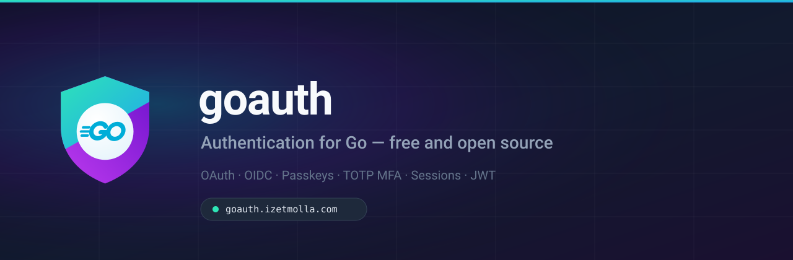

# goauth - **Authentication for Go.**

**Framework-agnostic authentication and authorization for Go**




Framework-agnostic authentication and authorization module for Go, built entirely on `net/http`. It provides OAuth 2.0 / OpenID Connect sign-in (Google, Azure AD, …), credentials authentication, passkeys, optional TOTP MFA, JWT access/refresh tokens, database-backed sessions (GORM) with optional Redis caching, cookie handling, CSRF protection, and role-based access control.

Because every handler is a plain `http.Handler` and every middleware is a standard `func(http.Handler) http.Handler`, goauth plugs into **any** Go web framework — the standard library, [Fiber](examples/fiber/README.md), [Gin](examples/gin/README.md), [Echo](examples/echo/README.md), chi, gorilla/mux, and so on.

## Documentation

Full guides, API walkthroughs, and framework examples:

**https://goauth.izetmolla.com/**

| Topic | Link |
|-------|------|
| Quick start | [goauth.izetmolla.com/docs/getting-started/quick-start](https://goauth.izetmolla.com/docs/getting-started/quick-start) |
| Configuration | [goauth.izetmolla.com/docs/guides/configuration](https://goauth.izetmolla.com/docs/guides/configuration) |
| Authenticator MFA (TOTP) | [goauth.izetmolla.com/docs/guides/mfa-totp](https://goauth.izetmolla.com/docs/guides/mfa-totp) |
| Login as | [goauth.izetmolla.com/docs/guides/login-as](https://goauth.izetmolla.com/docs/guides/login-as) |
| Passkeys | [goauth.izetmolla.com/docs/providers/passkey](https://goauth.izetmolla.com/docs/providers/passkey) |
| All provider presets | [goauth.izetmolla.com/docs/providers/presets/catalog](https://goauth.izetmolla.com/docs/providers/presets/catalog) |
| Frameworks | [goauth.izetmolla.com/docs/frameworks/net-http](https://goauth.izetmolla.com/docs/frameworks/net-http) |
| Go API reference | [pkg.go.dev/github.com/izetmolla/goauth](https://pkg.go.dev/github.com/izetmolla/goauth) |

## Features

- **OAuth 2.0 / OIDC sign-in** with discovery, PKCE, `state`, and `nonce` checks
- **Provider presets**: [Google](providers/google/README.md), [Azure AD / Entra ID](providers/azuread/README.md), [Credentials](providers/credentials/README.md), [Passkey](providers/passkey/README.md)
- **Authenticator MFA (TOTP)**: Google / Microsoft Authenticator–style codes — off by default ([docs](https://goauth.izetmolla.com/docs/guides/mfa-totp))
- **Login as**: admin impersonation via `{base}/login_as?user_id=` — off by default ([docs](https://goauth.izetmolla.com/docs/guides/login-as))
- **JWT tokens**: HS256/HS384/HS512 access + refresh token pairs with configurable lifetimes (`"60s"`, `"15m"`, `"7d"`, `"1y"`, ...)
- **Sessions**: persisted via GORM (any SQL database), optionally cached in Redis
- **Two protection modes**: Bearer-JWT for APIs and session-cookie (with sign-in redirect) for server-rendered pages
- **Role-based access control** with `name:perms` grants (`"admin:rw"`, `"hr:r"`)
- **Provider connect flow** for linking extra OAuth scopes/accounts to an existing user
- **Security**: signed double-submit CSRF cookies, `__Host-`/`__Secure-` cookie prefixes, cross-subdomain SSO cookies, PBKDF2-SHA256 password hashing

## Installation

```bash
go get github.com/izetmolla/goauth
```

Requires the Go version declared in [`go.mod`](go.mod) (route patterns with path parameters, available since Go 1.22, are used by the built-in mux).

## Quick start (net/http)

```go
package main

import (
	"context"
	"log"
	"net/http"

	"github.com/izetmolla/goauth"
	"github.com/izetmolla/goauth/providers/google"
	"gorm.io/driver/postgres"
	"gorm.io/gorm"
)

func main() {
	db, _ := gorm.Open(postgres.Open(dsn), &gorm.Config{})

	auth, err := goauth.New(&goauth.Config{
		JWTSecret: "change-me",                  // required
		AuthURL:   "https://app.example.com",    // external base URL
		DB:        db,                           // required (users + sessions)
		Providers: []goauth.Provider{
			google.New("GOOGLE_CLIENT_ID", "GOOGLE_CLIENT_SECRET"),
		},
		// Map the raw provider profile to a user in YOUR database.
		ResolveUser: func(ctx context.Context, profile goauth.Profile) (*goauth.User, bool, error) {
			// look up / provision by profile["email"], profile["sub"], ...
			return &goauth.User{ID: "uuid", Roles: goauth.JSONBArray{"admin:rw"}}, false, nil
		},
	})
	if err != nil {
		log.Fatal(err)
	}

	mux := http.NewServeMux()

	// All auth endpoints in one line (see "HTTP endpoints" below).
	mux.Handle(goauth.DefaultBasePath+"/", auth.Handler())

	// A JWT-protected API route.
	mux.Handle("/api/profile", auth.UseAPIAuthorization()(http.HandlerFunc(profileHandler)))

	// A cookie-protected page (redirects to /sign-in when unauthenticated).
	mux.Handle("/dashboard", auth.UseWEBAuthorization()(http.HandlerFunc(dashboardHandler)))

	log.Fatal(http.ListenAndServe(":3000", mux))
}
```

## HTTP endpoints

`auth.Handler()` returns an `http.Handler` that serves everything under `goauth.DefaultBasePath` (`/api/authorization`):

| Method | Path | Handler | Description |
|--------|------|---------|-------------|
| `GET` | `{base}/providers` | `GetProviders` | JSON list of configured providers (Auth.js-compatible shape) |
| `ANY` | `{base}/provider/{provider}` | `HandleSignIn` | Starts the sign-in flow (OAuth redirect, or credentials POST) |
| `ANY` | `{base}/provider/{provider}/callback` | `HandleCallback` | OAuth/OIDC callback; validates state/PKCE/nonce, exchanges the code, resolves the user, creates the session, and renders the callback page |
| `POST` | `{base}/provider/{provider}/register` | `HandleRegister` | Credentials sign-up (`CredentialsProvider.Register`), then signs the user in. **Off by default** (`Endpoints.EnableRegister`) |
| `GET` | `{base}/csrf` | `GetCSRFToken` | CSRF token for custom credentials forms |
| `POST` | `{base}/signout` | `HandleSignOut` | Revokes the current session (cookie or refresh token) and clears the cookie. Off with `Endpoints.DisableSignOut` |
| `GET` | `UI.SignInEndpoint`, `UI.RegisterEndpoint`, `UI.ForgotPasswordEndpoint`, `UI.OTPEndpoint`, `UI.VerifyEndpoint` (defaults `{base}/signin`, `/register`, `/forgot`, `/otp`, `/verify-email`) | `SignInPage`, `RegisterPage`, … | Built-in pages (embedded HTML, CSS, JS). **All off by default**: turn on with `UI.EnableAllUI` or one by one — see [Built-in pages](https://goauth.izetmolla.com/docs/guides/sign-in-page) |
| `POST` | `{base}/password/*`, `/otp/*`, `/verify-email*` | `HandleForgotPassword`, … | Password reset, one-time-code sign-in and email confirmation — see [Verification](https://goauth.izetmolla.com/docs/guides/verification). **Off by default** |
| `GET`/`POST` | `{base}/mfa/totp/*` | `HandleTOTPStatus`, … | Authenticator MFA enroll / disable / verify — see [MFA TOTP](https://goauth.izetmolla.com/docs/guides/mfa-totp). **Off by default** |
| `GET`/`POST` | `{base}/login_as` | `HandleLoginAs` | Admin login-as another user — see [Login as](https://goauth.izetmolla.com/docs/guides/login-as). **Off by default** |
| `GET` | `{base}/assets/{file}` | — | The page's versioned CSS/JS |

The sign-in APIs are on by default. Sign-up (`Endpoints.EnableRegister`), the verification features (`Config.Verification`) and every HTML page (`UI.EnableAllUI`, or `UI.EnableSignInPage`, `EnableRegisterPage`, `EnableForgotPasswordPage`, `EnableOTPPage`, `EnableVerifyPage`) are off until you enable them. Serve the pages at your own paths with `UI.SignInEndpoint: "/sign-in"` and friends. Switch built-in APIs off with `Config.Endpoints` (`DisableCredentials`, `DisableCSRF`, `DisableProviders`, `DisableSignOut`). Brand the pages and emails with `Config.UI` (`AppName`, `LogoURL`, `AccentColor`, `TermsURL`, `PrivacyURL`, `DefaultRedirect`).

All SQL goes through GORM's builder with portable column types, tested against the PostgreSQL, MySQL, SQL Server and SQLite dialects.

The handlers are also exported individually (all `http.HandlerFunc` compatible) if you prefer to register routes yourself.

Useful query parameters on the sign-in endpoint:

- `?json=true` (or header `X-Auth-Return-Redirect: 1` / `Accept: application/json`) — return the authorization URL as JSON instead of a 302 redirect
- header `X-Auth-Flow: token` — token flow for mobile/API clients: JSON responses, no session cookie, and no CSRF check (a cross-site form cannot set a header, so a query parameter never skips it)
- `?connect=1&resource_id=<uuid>` — provider **connect** flow: link the OAuth account/scopes to the **signed-in** user (requires the WEB session cookie, otherwise `401`); on completion the `Config.OnProviderConnect` callback runs with that user

## Middlewares

All middlewares are standard `func(http.Handler) http.Handler`:

```go
// Bearer JWT (Authorization header or ?access_token=) for APIs.
auth.UseAPIAuthorization(
	auth.WithRoles([]string{"admin"}),                // optional role gate
	auth.WithExcludedPaths([]string{"/api/public"}),  // optional path prefixes to skip
)

// Session cookie for server-rendered pages; unauthenticated requests are
// redirected to Config.SignInRedirectURL with ?redirectUrl=<original>.
auth.UseWEBAuthorization(...)

// Refresh-token endpoint middleware: activates only when the client sends
// the opt-in header (goauth.RefreshTokenHandlerIdentifier, "cft"),
// otherwise passes the request through to the next handler.
auth.HandleRefreshToken(next)
```

Inside a protected handler:

```go
claims, err := auth.GetClaims(r)      // jwt.MapClaims from the validated token
roles, err := auth.GetRoles(r)        // []string from the "roles" claim
data, err := auth.GetAuthDataAPI(r)   // AuthData{SessionID, UserID, Roles}
data, err := auth.GetAuthDataWEB(r, ctx) // same, resolved from the session cookie
```

## Configuration

```go
goauth.New(&goauth.Config{
	JWTSecret:            "...",         // required — HMAC signing secret
	AuthURL:              "https://...", // external origin; falls back to request headers when empty
	SigningMethod:        "HS256",       // HS256 (default) | HS384 | HS512
	AccessTokenDuration:  "60s",         // s/m/h/d/w/mo/y units supported
	RefreshTokenDuration: "1y",
	SignInRedirectURL:    "/sign-in",    // target of the WEB middleware redirect

	DB:          db,                     // *gorm.DB, required
	Redis:       redisClient,            // optional session cache
	RedisPrefix: "AUTHSESSIONS",
	RedisTTL:    30 * time.Minute,

	UserTableName:    "users",           // needs at least: id, roles
	SessionTableName: "sessions",        // see goauth.Session for the schema
	TablePrefix:      "goauth_",         // prefix for goauth-owned tables (not users/sessions)
	AutoMigrate:      true,             // create/update sessions + enabled feature tables in New

	CookieSessionName: "cnf.id",         // WEB session cookie name
	Cookies:           &goauth.CookieOptions{}, // per-cookie overrides

	Providers:         []goauth.Provider{...},  // see providers/README.md
	ResolveUser:       func(ctx, profile) (*goauth.User, bool, error) {...}, // required for OAuth
	OnProviderConnect: func(ctx, resourceID, account, user, providerID) error {...}, // optional; user = the signed-in user

	KeepRefreshTokenServerSide: true, // recommended: refresh token never reaches browser JS; web clients refresh via the session cookie
})
```

For single sign-on across subdomains (`example.com`, `admin.example.com`, ...) use:

```go
cookies := goauth.CrossSubdomainCookies(".example.com")
// Config.Cookies: &cookies  — all participating apps must share the same JWTSecret
```

## Tokens, sessions and roles

- `auth.Authorize(opts...)` creates a session row and signs an access/refresh pair. The OAuth callback does this automatically; call it yourself for custom flows (e.g. after an LDAP login).
- `auth.CheckSession(w, r)` validates a refresh token, refreshes the access token with up-to-date roles, and re-sets the session cookie.
- `auth.SignOut(w, r)`, `auth.RevokeSession(ctx, id)` and `auth.RevokeUserSessions(ctx, userID)` revoke sessions; `UseWEBAuthorization` stores the principal on the request context (`goauth.AuthDataFromContext`).
- Roles use the `name:perms` grant format, where perms is `r`, `w`, or `rw`. `auth.GetRole(endpointRoles, userRoles)` returns `(hasRole, canRead, canWrite)`.
- `goauth.HashPassword` / `goauth.CheckPassword` implement PBKDF2-SHA256 (`$pbkdf2-sha256$...`) for credentials storage.

## Framework integration

goauth itself never imports a framework. Each example is a self-contained, runnable module with its own README:

| Framework | Example | Adapter used |
|-----------|---------|--------------|
| Fiber v3 | [`examples/fiber`](examples/fiber/README.md) | `github.com/gofiber/fiber/v3/middleware/adaptor` |
| Gin | [`examples/gin`](examples/gin/README.md) | `gin.WrapH` + a 12-line middleware adapter (included) |
| Echo v5 | [`examples/echo`](examples/echo/README.md) | `echo.WrapHandler` / `echo.WrapMiddleware` (built in) |
| net/http | Quick start above | none needed |

See [`examples/README.md`](examples/README.md) for how to run and test them.

## Providers

| Provider | Package | Type |
|----------|---------|------|
| Google | [`providers/google`](providers/google/README.md) | OIDC (discovery, PKCE + state + nonce) |
| Azure AD / Entra ID | [`providers/azuread`](providers/azuread/README.md) | OIDC v2.0 endpoints, Microsoft Graph profile |
| Credentials | [`providers/credentials`](providers/credentials/README.md) | Username/password (custom `Authorize` function) |
| Passkey | [`providers/passkey`](providers/passkey/README.md) | WebAuthn (opt-in) |

[`providers/README.md`](providers/README.md) explains the provider model and how to write a custom provider (any OAuth/OIDC service can be configured with a plain `goauth.OAuthProvider` struct).

## License

MIT. See [LICENSE](LICENSE).

---

[Documentation](https://goauth.izetmolla.com/) · [pkg.go.dev](https://pkg.go.dev/github.com/izetmolla/goauth) · [GitHub](https://github.com/izetmolla/goauth)
